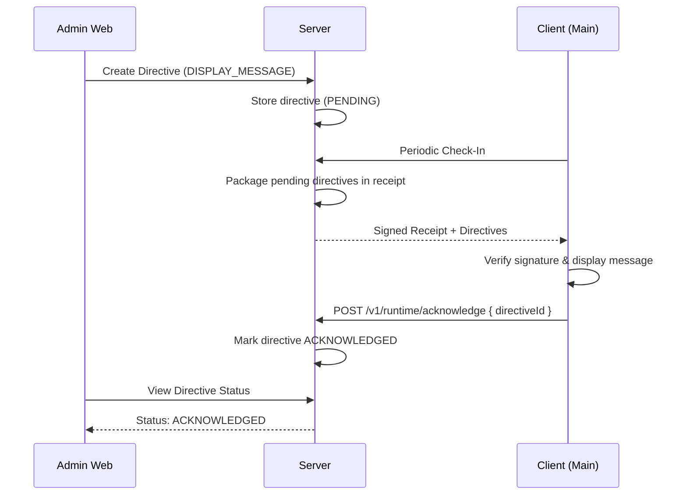

# Admin API Contract & Directives V1

## API Endpoint Table

| Endpoint | Method | Role | Description |
|---|---|---|---|
| `/admin/v1/licenses` | POST | ADMIN/OWNER | Create a new license |
| `/admin/v1/licenses/:id` | GET | AUDITOR+ | View license details |
| `/admin/v1/licenses/:id/revoke` | POST | ADMIN/OWNER | Revoke a license |
| `/admin/v1/licenses/:id/disable` | POST | ADMIN/OWNER | Temporarily disable license |
| `/admin/v1/licenses/:id/restore` | POST | ADMIN/OWNER | Restore disabled license |
| `/admin/v1/directives` | POST | SUPPORT+ | Send an allowed directive |
| `/admin/v1/customers` | GET/POST | SUPPORT+ | Manage customers |
| `/admin/v1/audit` | GET | AUDITOR+ | View audit logs |

## Directive Protocol
Directives allow admins to send messages and non-code commands to clients.

**Allow List:**
- `DISPLAY_MESSAGE`
- `REQUIRE_RECHECK`
- `CONTACT_SUPPORT`
- `REQUIRE_UPDATE`
- `REQUIRE_DEACTIVATION`

**Prohibited:**
- Code execution, file operations.

**Directive Schema:**
```json
{
  "directiveId": "uuid",
  "targetBindingId": "uuid",
  "type": "DISPLAY_MESSAGE",
  "title": "License Notice",
  "payload": "Please contact support.",
  "priority": "HIGH",
  "createdAt": "ISO8601",
  "expiresAt": "ISO8601",
  "status": "PENDING",
  "requiresAcknowledgement": true
}
```

## Admin-to-Client Directive Sequence

