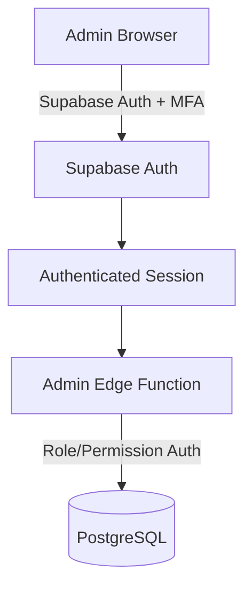

# Admin Platform Specification V1

## Purpose
A completely separate professional web application replacing terminal/manual license administration. It is NOT part of the Electron renderer.

## Core Features
- Dashboard
- Customers
- Licenses
- Devices
- Check-ins
- Requests
- Audit Logs
- Admin Users
- Settings

## Architecture Diagram

## Admin Authentication & Roles
- The browser authenticates as an admin user (MFA supported).
- Never expose privileged database secrets or private keys to the browser.
- **Roles**:
  - `OWNER`: full access
  - `ADMIN`: license/customer/device/check-in/request operations
  - `SUPPORT`: visibility and directive delivery
  - `FINANCE`: renewal/billing related
  - `AUDITOR`: read-only

## Entity Management
- **Customer**: `customerId`, `businessName`, `contactName`, `email`, `phone`
- **License**: Admin can create, view, extend, disable, restore, revoke. Keys only shown at creation.
- **Device**: Views based on `deviceKeyId`, checks binding state, platform, app version, last seen.

## Check-In Monitoring
Dashboard statistics categorize statuses:
- CURRENT
- DUE_SOON
- REQUIRED
- OVERDUE
- REVOKED
- DISABLED
- EXPIRED

Real-time presence is not used. "Last check-in" and "Next check-in due" are standard.
