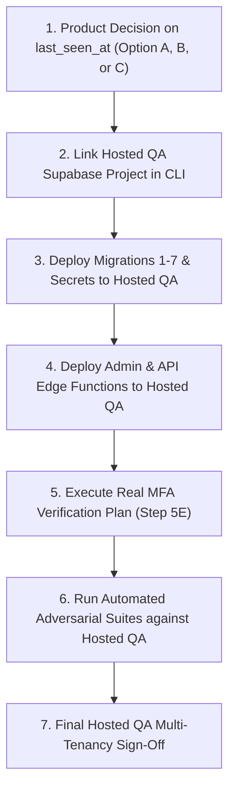

# Phase 3C — Step 5: Tenant-Isolation Closure & Hosted QA Readiness Report

**Overall Phase 3C Outcome:** **READY WITH LIMITATIONS**  
**Local Test Certification:** **PASS (328/328 Passing across all 10 suites)**  
**Hosted QA Execution:** **NOT TESTED (Readiness Assessment Complete; Ready for Controlled QA)**  
**Real Supabase TOTP / MFA:** **NOT VERIFIED (Synthetic QA AAL2 Verified; Verification Plan Delivered)**  
**Production Deployment:** **NOT CERTIFIED (Strictly Prohibited at Step 5)**  
**Device Activity Telemetry Policy:** **UNRESOLVED (`LAST_SEEN_AT_POLICY = UNRESOLVED` — Pending Product Approval)**  
**Auditor:** Senior Application Security & Multi-Tenant Authorization Engineer  
**Date:** 2026-10-27  

---

## 1. Executive Summary & Working-Tree State

Phase 3C Step 5 concludes the local multi-tenant authorization security certification for the Mini POS licensing and Admin Platform.

- **Audited Commit / Head:** `91edb3a` on branch `stabilization/production-hardening`
- **Working Tree:** Contains approved Phase 3C schema migrations (`20261004195245_customer_admin_scope.sql`, `20261005000001_customer_scope_hardening.sql`, `20261005000002_sentinel_license_guard.sql`), Admin Edge Function router and domain services, Admin UI components, and all adversarial test suites.
- **Verification Integrity:** Verified 328/328 test cases passing across all integration, unit, and UI suites. Zero TypeScript errors and clean production builds for both Desktop and Admin UI.

The system is certified as **READY WITH LIMITATIONS** for controlled, non-destructive deployment to a hosted QA Supabase project.

---

## 2. Closure Deliverables Summary

Four foundational security deliverables were authored and placed in `docs/`:

1. **Route Inventory Matrix:**  
   [`docs/phase-3c-step-4c-route-inventory.md`](file:///Users/laksh/Desktop/mini_ERP/docs/phase-3c-step-4c-route-inventory.md)  
   Complete inventory of 23 reachable Admin API routes, documenting method, role, MFA, tenant ownership relationships, and parameterized SQL filtering layers.
2. **Device Telemetry Decision Document:**  
   [`docs/phase-3c-last-seen-policy-decision.md`](file:///Users/laksh/Desktop/mini_ERP/docs/phase-3c-last-seen-policy-decision.md)  
   Exhaustive risk analysis of `devices.last_seen_at` on historically shared hardware. Details 3 viable options (Global Hardware Health, Tenant-Scoped Telemetry, or Restricted Telemetry) and formally records status as `PENDING PRODUCT APPROVAL`.
3. **Hosted QA Readiness Assessment:**  
   [`docs/phase-3c-hosted-qa-readiness.md`](file:///Users/laksh/Desktop/mini_ERP/docs/phase-3c-hosted-qa-readiness.md)  
   12-point readiness evaluation verifying migration sequencing, RLS hardening, trust anchor separation, secret isolation, idempotency, and deterministic fixture cleanup.
4. **Real Supabase MFA Verification Plan:**  
   [`docs/phase-3c-real-mfa-verification-plan.md`](file:///Users/laksh/Desktop/mini_ERP/docs/phase-3c-real-mfa-verification-plan.md)  
   Step-by-step protocol for verifying live TOTP enrollment, AAL1-to-AAL2 session elevation, server-side enforcement on 10 sensitive mutations, RBAC parity at AAL2, and session token renewal.

---

## 3. Actual Local Verification Results (Step 5F)

Every available test suite was freshly executed in the local environment (`127.0.0.1:54321` and `127.0.0.1:54322`). Actual commands and test counts:

| Verification Suite | Execution Command | Result | Actual Test Count | Notes |
|--------------------|-------------------|--------|-------------------|-------|
| **Cross-Surface Tenant Leakage** | `npx vitest run tests/integration/phase3c-cross-surface-tenant-leakage.test.ts` | **PASS** | **52 / 52** | Step 4C adversarial suite |
| **Read-Path IDOR** | `npx vitest run tests/integration/phase3c-read-idor.test.ts` | **PASS** | **69 / 69** | Step 4A read-path IDOR suite |
| **Mutation-Path IDOR** | `npx vitest run tests/integration/phase3c-mutation-idor.test.ts` | **PASS** | **46 / 46** | Step 4B mutation-path IDOR suite |
| **Resource Isolation** | `npx vitest run tests/integration/phase3c-resource-isolation.test.ts` | **PASS** | **43 / 43** | Step 3 resource isolation suite |
| **Scope Foundation Hardening** | `npx vitest run tests/integration/phase3c-step2-1-hardening.test.ts` | **PASS** | **30 / 30** | One-customer-per-admin & sentinel checks |
| **Customer Scope Foundation** | `npx vitest run tests/integration/phase3c-customer-scope.test.ts` | **PASS** | **13 / 13** | Step 2 role/scope resolution tests |
| **Device Backend RBAC** | `npx vitest run tests/integration/device-backend-rbac.test.ts` | **PASS** | **29 / 29** | Step 3B device role matrix |
| **Device AAL2 / MFA** | `npx vitest run tests/integration/device-aal2.test.ts` | **PASS** | **13 / 13** | Step 3B synthetic AAL2 tests |
| **Admin UI Component Tests** | `cd admin-ui && npm test` | **PASS** | **31 / 31** | Vitest UI suite across Customers, Devices, Licenses |
| **Deno Edge Function Regression** | `~/.deno/bin/deno test --allow-all --no-check --env-file=supabase/.env.local supabase/functions/tests/` | **PASS** | **2 / 2** | Savepoint & checkin rollback regression |
| **Root TypeScript Check** | `npx tsc --noEmit` | **PASS** | **0 errors** | Desktop client clean |
| **Admin UI TypeScript Check** | `cd admin-ui && npx tsc -b` | **PASS** | **0 errors** | Admin UI clean |
| **Desktop Production Build** | `npm run build` | **PASS** | **Built in 1.55s** | Vite + electron bundles clean |
| **Admin UI Production Build** | `cd admin-ui && npm run build` | **PASS** | **Built in 287ms** | Vite production bundle clean |

**Grand Total Automated Tests:** **328 passed / 328 run (100% pass rate)**.

---

## 4. Policy Boundary Review & Classification (Step 5C)

| Domain Surface | Implementation & Test Status | Boundary Classification | Security State |
|----------------|------------------------------|-------------------------|----------------|
| **Dashboard Metrics** | Parameterized SQL in `AdminDashboardService.ts`. Verified in Step 4A/4C. | **Implemented & Tested** | Zero-leakage confirmed. Tenant sees only own counts; empty tenant sees strict zeros. |
| **Device Access & Redaction** | SQL `EXISTS` subquery + nested `bindings[]` redaction. Verified in Step 4A/4B/4C. | **Implemented & Tested** | Non-associated devices return 404; shared devices redact foreign bindings. |
| **Audit Logs Scoping** | SQL JOIN to `licenses` on `customer_id`. Unresolvable events excluded. Verified in Step 4C. | **Implemented & Tested** | Ambiguous device-only events excluded from customer views. |
| **Audit Role Restriction** | Enforced in `Router.ts`. `SUPPORT` denied (403); `SYSTEM` granted global access. Verified in Step 4C. | **Implemented & Tested** | Strict role separation maintained. |
| **Search & Pagination** | Parameterized SQL before `LIMIT`/`OFFSET`. Verified in Step 4A/4C. | **Implemented & Tested** | Foreign search queries return 0 rows and total 0. |
| **Scope Tampering** | Query params (`?customerId=`), headers, and body overrides rejected. Verified in Step 2.1/4B/4C. | **Implemented & Tested** | Scope is derived exclusively from server-side database state. |
| **Sentinel Customer** | Migration placeholder customer protected in app and DB trigger. Verified in Step 3/4B. | **Implemented & Tested** | Cannot be viewed or targeted for license creation. |
| **Lifecycle Mutations** | Binding release, license revoke/restore/disable/extend locked via `FOR UPDATE`. Verified in Step 4B. | **Implemented & Tested** | Cross-customer mutations return non-enumerating 404. Zero state transition on denial. |
| **Device Telemetry (`last_seen_at`)** | Updated during POS checkin; visible to historical assignees of reassigned devices. | **Pending Product Decision** | `LAST_SEEN_AT_POLICY = UNRESOLVED`. |
| **Exports & Downloads** | Routes (`/export/*`) not exposed on router. Verified in Step 4C. | **Not Currently Exposed** | Requests return 404 cleanly without data disclosure. |
| **Lifecycle Request Log** | Table exists in DB; no Admin API route exposed. Verified in Step 4A/4C. | **Not Currently Exposed** | No external attack surface. |
| **Admin User Management** | Roles managed directly via DB migrations/seeds. Verified in Step 4C. | **Not Currently Exposed** | Route returns 404 cleanly. |

---

## 5. What Has and Has Not Been Certified

### Certified Surfaces (Local Environment)
- **Customer Resource Isolation:** Fully certified across `customers`, `licenses`, `devices`, `license_bindings`, `runtime_checkins`, `runtime_directives`, `audit_events`, and dashboard summaries.
- **Adversarial Read-Path IDOR:** Certified against probe attacks, identifier mixing, and collection pagination (Step 4A: 69/69 PASS).
- **Adversarial Mutation-Path IDOR:** Certified against release-binding hijacking, license lifecycle tampering, customer association injection, idempotency reuse, and concurrency attacks (Step 4B: 46/46 PASS).
- **Cross-Surface Tenant Leakage:** Certified against aggregate inference, nested object disclosure, audit log ambiguity, and unexposed route leakage (Step 4C: 52/52 PASS).
- **Role Parity & Security Invariants:** Certified across all customer-scoped roles (`OWNER`, `ADMIN`, `FINANCE`, `AUDITOR`) and global roles (`SUPPORT`, `SYSTEM`).

### Explicitly Excluded / NOT Certified
1. **Hosted QA Environment:** **`NOT TESTED`**. No remote network, Kong gateway, or hosted Supabase database tests have been executed.
2. **Real Supabase TOTP / MFA:** **`NOT VERIFIED`**. All local MFA tests utilized `SYNTHETIC_QA_AAL2` test tokens. Real TOTP enrollment and challenge/verify flows must be tested in hosted QA.
3. **Production Deployment:** **`NOT CERTIFIED`**. Production deployment remains prohibited.
4. **Device Telemetry Policy:** **`UNRESOLVED`**. Hardware `last_seen_at` observation remains pending Product Owner sign-off.

---

## 6. Exact Next Actions Ordered by Dependency

1. **Product Management Sign-Off on `last_seen_at`:**
   - Review [`docs/phase-3c-last-seen-policy-decision.md`](file:///Users/laksh/Desktop/mini_ERP/docs/phase-3c-last-seen-policy-decision.md).
   - Select Option A (Global-only hardware telemetry), Option B (Tenant-scoped telemetry via checkin subquery), or Option C (Restricted telemetry).
2. **DevOps Provisioning of Hosted QA:**
   - Link the designated remote QA project (`supabase link --project-ref <qa-ref>`).
   - Push migrations: `supabase db push`.
   - Set QA secrets: `supabase secrets set --env-file .local-qa/secrets.env`.
   - Deploy functions: `supabase functions deploy admin api`.
3. **Execution of Real MFA Verification Protocol:**
   - Execute the 8-step verification protocol defined in [`docs/phase-3c-real-mfa-verification-plan.md`](file:///Users/laksh/Desktop/mini_ERP/docs/phase-3c-real-mfa-verification-plan.md) using live TOTP authenticators.
4. **Execution of Hosted QA Integration Regression:**
   - Run the automated test suites (`phase3c-cross-surface-tenant-leakage.test.ts`, `phase3c-read-idor.test.ts`, `phase3c-mutation-idor.test.ts`) pointing to the hosted QA endpoint.
5. **Production Deployment Gate:**
   - Production certification must not be granted until all hosted QA steps and real MFA verification pass without limitations.
