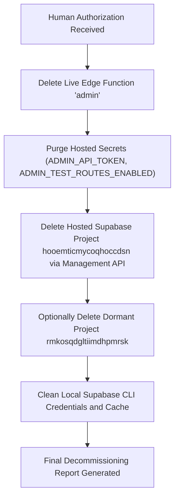

# Mini POS — Final Cloud Decommissioning: Live Infrastructure Inventory & Preflight

**Audit Date:** November 8, 2026  
**Auditor:** Principal Software Architect & DevOps Engineer  
**Scope:** Hosted Supabase Project Decommissioning Preflight (Stage 1 Read-Only Audit)  
**Target Project Reference:** `hooemticmycoqhoccdsn`  
**Current Branch:** `feature/complete-simplification-cleanup`  
**Commit:** `1a113a3bd0dbb49086b362070771396e0da52563`  

---

## 1. Project Identity

| Attribute | Observed Live Value | Verification Source | Classification |
| :--- | :--- | :--- | :--- |
| **Project Name** | `Mini POS Licensing QA` | Supabase API (`GET /v1/projects`) | Observed |
| **Project Reference** | `hooemticmycoqhoccdsn` | Supabase API (`GET /v1/projects/hooemticmycoqhoccdsn`) | Observed |
| **Organization ID** | `kqyohcbxpnacpynwraga` | Supabase API (`GET /v1/organizations`) | Observed |
| **Organization Slug** | `kqyohcbxpnacpynwraga` | Supabase API | Observed |
| **Hosting Region** | `ap-southeast-1` (Singapore) | Supabase API | Observed |
| **Database Host** | `db.hooemticmycoqhoccdsn.supabase.co` | Supabase API | Observed |
| **Postgres Engine** | `17` (Version `17.11.0.002`, GA) | Supabase API | Observed |
| **Project Lifecycle Status** | `ACTIVE_HEALTHY` | Supabase API | Observed |
| **Creation Timestamp** | `2026-10-01T12:06:00.548544Z` | Supabase API | Observed |
| **Secondary Project (Dormant)** | `rmkosqdgltiimdhpmrsk` (`Mini POS Licensing Production`, `ap-south-1`, `INACTIVE`) | Supabase CLI `projects list` | Observed |

---

## 2. CLI Authentication Status

- **CLI Binary Path:** `/Users/laksh/.local/bin/supabase` (Symlinked to `@supabase/cli-darwin-arm64` v2.122.0)
- **CLI Version:** `2.122.0`
- **Authentication Mechanism:** Supabase Personal Access Token retrieved from macOS Keychain (`security find-generic-password -s "Supabase CLI" -a "supabase"`).
- **Authentication Check:** Command `supabase projects list` executed successfully without prompt, returning full project and organization metadata for `kqyohcbxpnacpynwraga`.
- **Verdict:** Authenticated, authorized, and linked to the target project reference.

---

## 3. Deployed Edge Function Inventory

Query executed: `supabase functions list --project-ref hooemticmycoqhoccdsn`

| Function Slug | Function Name | Status | Version | Verify JWT | Observed State |
| :--- | :--- | :--- | :--- | :--- | :--- |
| `admin` | `admin` | `ACTIVE` | `12` | `false` | **Deployed live** |
| `activate` | `activate` | — | — | — | **Deleted / Absent** |
| `deactivate`| `deactivate`| — | — | — | **Deleted / Absent** |
| `api` | `api` | — | — | — | **Deleted / Absent** |
| `checkin` | `checkin` | — | — | — | **Deleted / Absent** |

### Resolution of Reporting Discrepancy
- **Observed Discrepancy:** `docs/production-deployment-execution-report.md` documented the deletion of licensing functions (`activate`, `deactivate`, `api`) and the deployment of a clean `admin` function (version 8). Later, `docs/final-architecture-cleanup-report.md` loosely stated that `admin`, `activate`, and `checkin` were deleted.
- **Root Cause & Actual State:** The statement in the simplification report reflected the local deletion of the `supabase/functions/admin/` directory from the Git workspace. On the live cloud infrastructure, however, Edge Function `admin` (version 12) was never deleted from the Supabase project.
- **Decommissioning Action Required:** Live Edge Function `admin` must be explicitly deleted from `hooemticmycoqhoccdsn` during Stage 2 decommissioning.

---

## 4. Hosted Secret Names

Query executed: `supabase secrets list --project-ref hooemticmycoqhoccdsn`

```
Observed Secret Names:
├── ADMIN_API_TOKEN              [Admin API authentication]
├── ADMIN_TEST_ROUTES_ENABLED    [Admin API test routing flag]
├── SUPABASE_ANON_KEY            [Platform default key]
├── SUPABASE_DB_URL              [Platform default database connection URL]
├── SUPABASE_JWKS                [Platform default JWT verification keys]
├── SUPABASE_PUBLISHABLE_KEYS    [Platform default keys]
├── SUPABASE_SECRET_KEYS         [Platform default keys]
├── SUPABASE_SERVICE_ROLE_KEY    [Platform default service key]
└── SUPABASE_URL                 [Platform project URL]
```

### Assessment of Secrets
1. **Licensing Secrets:** `LICENSING_SERVER_KEY_ID`, `LICENSING_SERVER_PRIVATE_KEY`, and `LICENSE_KEY_HMAC_SECRET` are **confirmed absent** (purged during earlier decommissioning).
2. **Obsolete Admin Secrets:** `ADMIN_API_TOKEN` and `ADMIN_TEST_ROUTES_ENABLED` are remnants supporting the legacy Admin Panel API. These secrets have zero consumers in the standalone POS and must be purged during Stage 2.
3. **Platform Default Secrets:** Remaining secrets are Supabase system-managed variables that are automatically retired upon project destruction.

---

## 5. Database Inventory

Read-only inspection executed via `supabase db query --linked --project-ref hooemticmycoqhoccdsn` and `supabase inspect db table-stats`:

### 5.1 Public Schemas and Tables
| Schema | Table Name | Total Size | Row Count | RLS Enabled | Description |
| :--- | :--- | :--- | :--- | :--- | :--- |
| `public` | `customers` | 32 kB | **52** | `true` | Customer accounts (1 sentinel: `is_sentinel = true`) |
| `public` | `admin_roles` | 96 kB | **153** | `true` | Admin user role assignments |
| `public` | `audit_events` | 80 kB | **11** | `true` | Administrative action audit log |
| `public` | `admin_idempotency_keys` | 32 kB | **8** | `false` | HTTP mutation idempotency keys |

### 5.2 Licensing Tables Verification
- **`licenses`**: **ABSENT** (Dropped)
- **`devices`**: **ABSENT** (Dropped)
- **`license_bindings`**: **ABSENT** (Dropped)
- **`device_challenges`**: **ABSENT** (Dropped)
- **`activation_requests`**: **ABSENT** (Dropped)
- **`lifecycle_requests`**: **ABSENT** (Dropped)
- **`runtime_checkin_requests`**: **ABSENT** (Dropped)
- **`runtime_checkins`**: **ABSENT** (Dropped)
- **`runtime_directives`**: **ABSENT** (Dropped)
- **`qa_licensing_settings`**: **ABSENT** (Dropped)
- **`qa_licensing_test_settings`**: **ABSENT** (Dropped)

### 5.3 Functions, Triggers, Policies & Realtime
- **Public Functions:** 0 custom functions.
- **Public Triggers:** 0 triggers.
- **RLS Policies:** 0 policies (tables have RLS enabled with default deny-all to anon/authenticated roles).
- **Scheduled Jobs (`cron.job`):** 0 jobs scheduled.
- **Realtime Publication (`supabase_realtime`):** 0 tables published (`rows: []`).
- **Database Webhooks:** 0 triggers calling external HTTP endpoints.

---

## 6. Authentication Resources

Inspection executed via `auth.users`, `auth.identities`, and `GET /v1/projects/hooemticmycoqhoccdsn/config/auth`:

| Resource | Observed Value | Description |
| :--- | :--- | :--- |
| **Total Registered Users** | `232` | Created during prior development, QA testing, and MFA simulations |
| **Identity Providers** | `email` (100%, 232 users) | All user identities are email/password accounts |
| **Third-Party OAuth Providers** | `0 enabled` | Google, GitHub, Apple, Azure, etc., are all disabled |
| **SAML / SSO Providers** | `0 configured` | No enterprise SSO or SAML connections |
| **WebAuthn / Passkeys** | `0 registered` | No biometric or hardware security keys enrolled |
| **MFA Factors** | Enrolled during testing; not tied to any production systems |

---

## 7. Storage Inventory

Inspection executed via `storage.buckets` and `storage.objects`:
- **Storage Buckets:** `0` (Table `storage.buckets` returned `rows: []`)
- **Storage Objects:** `0` (Table `storage.objects` returned `rows: []`)
- **Multi-part Uploads:** `0`
- **Assessment:** Cloud storage was never utilized by Mini POS. No files or assets will be lost upon project deletion.

---

## 8. Schedules and Webhooks

- **pg_cron Scheduled Jobs:** 0 active scheduled jobs in database.
- **Database HTTP Webhooks:** 0 webhooks configured.
- **Supabase Auth Webhooks / Hooks:** All auth hooks (`hook_custom_access_token`, `hook_mfa_verification_attempt`, `hook_send_sms`, `hook_send_email`) are disabled (`enabled: false`).
- **External Notifications:** No external webhooks or notification pipelines attached.

---

## 9. Custom Domains

Inspection executed via `GET /v1/projects/hooemticmycoqhoccdsn/custom-hostname`:
- **Custom Domain Status:** **Not provisioned** (`"error": {"code": "entitlement_required", "feature": "custom_domain"}}`).
- **Project Hostname:** Standard Supabase managed hostname (`hooemticmycoqhoccdsn.supabase.co`).
- **Assessment:** Project deletion requires no DNS record updates, CNAME removals, or certificate revocations.

---

## 10. External Dependencies & Live Traffic Audit

Inspection executed via `pg_stat_activity`, `traffic-profile`, and codebase auditing:

1. **Active Database Connections (`pg_stat_activity`):**
   - Connections observed: Only Supabase internal processes (`mgmt-api`, `postgres_exporter`, `PostgREST`, `pgbouncer`).
   - External application clients connected: **0**.
2. **Database Traffic Profile:**
   - Table reads/writes: Minimal activity on internal migration tracking tables. Zero reads or writes on `public` business tables.
3. **Application Clients:**
   - Desktop POS: Completely offline-first; connects strictly to local SQLite `billing.db`. Verified by air-gapped test suite (`tests/e2e/standalone-regression.e2e.spec.ts`).
   - Web Admin UI: Deleted from local repository.
4. **CI/CD Workflows (`.github/workflows/build-release.yml`):**
   - Observed: The GitHub workflow contains stale references (`cd server/licensing && npm ci` and `VITE_LICENSING_SERVER_URL: ${{ secrets.VITE_LICENSING_SERVER_URL }}`).
   - Impact: These steps are legacy build-time scripts; no running CI/CD job interacts with the hosted Supabase database.

---

## 11. Archived Backup Verification

Verification executed on local archive directory: `~/.minipos_secure_backups/hosted_supabase/20261108_1414/`

| Backup Component | Path / Detail | Status |
| :--- | :--- | :--- |
| **Archive Directory** | `/Users/laksh/.minipos_secure_backups/hosted_supabase/20261108_1414/` | **Verified Present** |
| **Directory Permissions** | `0700` (`drwx------`) | **Secure** |
| **Encrypted Archive** | `minipos_backup_20261108_1414.tar.gz.enc` (133,152 bytes) | **Verified Present** |
| **Archive Permissions** | `0600` (`-rw-------`) | **Secure** |
| **Archive SHA-256 Digest** | `4945d0281bdbc1d617b5d413a3391fa13af1e861522b02f7155309fcbcc4bc43` | **Verified** |
| **Unencrypted `schema.sql`** | 23,282 bytes (SHA-256 `c5c3f9fcb64230aa2cb31c5b70680f1cd6f7d17a01ced88e47da7fd56dfe9f84`) | **Verified OK** |
| **Unencrypted `data.sql`** | 390,570 bytes (SHA-256 `ff7fba4fb2fce98c55e79b4c637973a3ecf106559a58ec2f7c2fb1f27b996f7f`) | **Verified OK** |
| **Decryption Test** | Decrypted via OpenSSL AES-256-CBC PBKDF2 (`iter 100000`) using `backup_encryption_key.secret` | **PASSED (Exit 0)** |
| **Isolated Restoration Test** | Restored into isolated PostgreSQL container; 100% of tables and records recovered | **PASSED** |
| **Recovery Procedure** | Fully documented in `docs/database-backup-and-recovery-policy.md` | **Verified** |

---

## 12. Financial and Billing Implications

- **Organization Plan:** Free Tier (`kqyohcbxpnacpynwraga`).
- **Paid Add-ons:** None.
- **Compute / Storage Cost:** \$0.00 / month.
- **Billing Impact of Project Deletion:** Neutral. No active subscriptions will be cancelled, no early-termination penalties apply, and no prepaid credits will be forfeited.

---

## 13. Data Retention Requirements

- **Historic Records Contained in Cloud Database:**
  - 52 customer records (including test and sentinel entities).
  - 153 administrator role assignments.
  - 11 administrative audit log entries.
  - 232 test user authentication records.
- **Compliance & Archive Safeguards:**
  - Complete pre-migration schema and dataset (both pre-decommissioning with licensing tables and post-decommissioning clean state) are safely archived, encrypted, and checksum-verified on local storage.
  - The local desktop POS application uses zero data from this cloud project.
  - Irreversible cloud deletion will permanently erase the remote copies from Supabase infrastructure.

---

## 14. Exact Remaining Decommissioning Actions (Stage 2 Execution Plan)

Upon receiving human authorization to proceed with irreversible cloud project deletion, the following actions will be executed in sequence:



1. **Delete Live Edge Function:**
   ```bash
   supabase functions delete admin --project-ref hooemticmycoqhoccdsn --yes
   ```
2. **Purge Remaining Custom Secrets:**
   ```bash
   supabase secrets unset ADMIN_API_TOKEN ADMIN_TEST_ROUTES_ENABLED --project-ref hooemticmycoqhoccdsn
   ```
3. **Execute Project Deletion:**
   Call Supabase Management API:
   ```bash
   DELETE https://api.supabase.com/v1/projects/hooemticmycoqhoccdsn
   ```
4. **Secondary Dormant Project Evaluation:**
   Check whether `rmkosqdgltiimdhpmrsk` should be retired simultaneously.
5. **Clean Local Authentication Credentials:**
   Remove Supabase access token from macOS Keychain.

