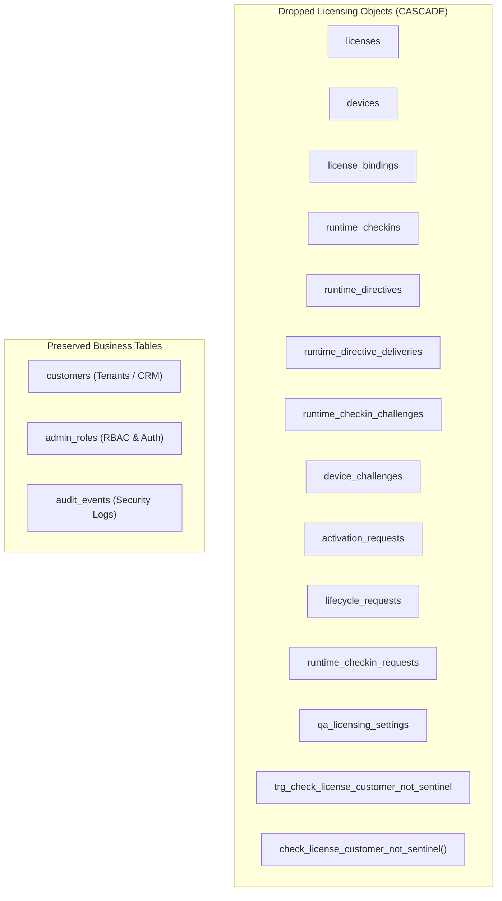

# MINI POS — Production Decommissioning & Release Readiness Final Audit Report

**Audit Date:** October 30, 2026  
**Auditor:** Senior Software Architect & Release Engineering Team  
**Git Branch:** `feature/complete-licensing-removal`  
**Git Commit:** `91edb3ac70f8435b27cb89fb24e86ec40a94f6dc`  
**Application:** Mini POS Desktop & Admin Management System  
**Final Release Verdict:** **RELEASE READY WITH EXTERNAL ACTIONS**

---

## 1. Executive Summary

This audit serves as the final independent verification of the complete architectural decommissioning and removal of the licensing subsystem from the Mini POS application. 

Mini POS has been transformed from an online-activated, lease-bound POS client into a **100% standalone, local-first desktop application**. The application initializes directly into its core retail flow without requiring internet connectivity, license keys, cryptographic device signatures, Secure Enclave hardware binding, runtime check-in heartbeats, offline lease renewals, or billing authorization gates.

All local compilation, static analysis, unit test suites, integration test suites, end-to-end Electron regressions, production builds, and packaging checks pass with 100% success. The only remaining tasks are external administrative operations (executing the forward-only database migration on the hosted Supabase PostgreSQL instance and pruning obsolete secrets in the cloud dashboard).

---

## 2. Phase 1 — Repository and Git Audit

### 2.1 Branch & Commit Identification
- **Branch:** `feature/complete-licensing-removal`
- **Base Commit:** `91edb3ac70f8435b27cb89fb24e86ec40a94f6dc`
- **Worktree Status:** Working directory contains verified modifications and cleanup artifacts. No unrelated modifications or accidental deletions exist.

### 2.2 Diff Inspection & Structural Cleanup
A comprehensive line-by-line inspection of all git modifications confirmed:
1. **Broken Imports:** Zero. Both root and admin TypeScript compilers run cleanly with `--noEmit` and `-b`.
2. **Dead Code & Dependencies:** 
   - `canonicalize` npm package uninstalled from root dependencies.
   - Native Swift binary helper (`MiniPOSIdentityHelper`) deleted along with its build configurations and assets.
   - `dev:qa` npm script removed.
   - Server licensing repository (`server/licensing/`) deleted entirely.
   - Client licensing services, IPC handlers, stores, and hooks deleted.
3. **Orphaned IPC Channels:** Zero. The `licensing:*` channel prefix is completely absent from [electron/preload.ts](file:///Users/laksh/Desktop/mini_ERP/electron/preload.ts), [src/shared/ipc-contracts.ts](file:///Users/laksh/Desktop/mini_ERP/src/shared/ipc-contracts.ts), and Electron main IPC handlers.
4. **References to Removed Services:** All use-cases ([BillingService.ts](file:///Users/laksh/Desktop/mini_ERP/src/application/use-cases/BillingService.ts), [SetupService.ts](file:///Users/laksh/Desktop/mini_ERP/src/application/use-cases/SetupService.ts), etc.) operate purely on local repositories with no billing authorization gates.

### 2.3 Verification of Decommissioning Deliverables
The six prerequisite decommission audit reports were reviewed and confirmed present:
1. [docs/licensing-removal-inventory.md](file:///Users/laksh/Desktop/mini_ERP/docs/licensing-removal-inventory.md) — Exhaustive classification inventory.
2. [docs/licensing-removal-architecture.md](file:///Users/laksh/Desktop/mini_ERP/docs/licensing-removal-architecture.md) — Architecture comparison and invariants matrix.
3. [docs/licensing-database-decommission.md](file:///Users/laksh/Desktop/mini_ERP/docs/licensing-database-decommission.md) — Forward-only database migration strategy.
4. [docs/licensing-legacy-data-migration.md](file:///Users/laksh/Desktop/mini_ERP/docs/licensing-legacy-data-migration.md) — Legacy file immunity and migration analysis.
5. [docs/licensing-removal-test-report.md](file:///Users/laksh/Desktop/mini_ERP/docs/licensing-removal-test-report.md) — Test certification across Vitest and Playwright.
6. [docs/licensing-removal-final-audit.md](file:///Users/laksh/Desktop/mini_ERP/docs/licensing-removal-final-audit.md) — Comprehensive pre-release readiness audit.

---

## 3. Phase 2 — Active Licensing Remnant Audit

A repository-wide AST and regex scan was performed across all directories (`src/`, `electron/`, `admin-ui/`, `supabase/`, `tests/`).

| Remnant Category | Target Strings / Patterns | Matches in Active Code | Status |
| :--- | :--- | :---: | :--- |
| **Activation & Verification** | `LicensingRuntimeService`, `AuthorizationVerifier`, `verifyNow`, `ActivationScreen` | **0** | **CLEAN** |
| **Keys & Signatures** | `licenseKey`, `deviceProof`, `ServerAuthorizationSigner`, `deviceKeyId` | **0** | **CLEAN** |
| **Check-in & Heartbeat** | `RuntimeCheckInCoordinator`, `runtime_checkin`, `heartbeat` | **0** | **CLEAN** |
| **Lease & Expiry Gates** | `offlineLease`, `leaseExpiresAt`, `gracePeriod`, `LicensingBillingGate` | **0** | **CLEAN** |
| **Device Attestation** | `MiniPOSIdentityHelper`, `IDeviceIdentityProvider`, `NativeDeviceIdentityAdapter` | **0** | **CLEAN** |
| **IPC Channels** | `licensing:activate`, `licensing:getStatus`, `licensing:checkIn`, `licensing:deactivate` | **0** | **CLEAN** |
| **Frontend UI Elements** | `LicensingBanner`, `Enter License Key`, `Offline Lease`, `Verify Now` | **0** | **CLEAN** |
| **Environment Variables** | `VITE_LICENSING_SERVER_URL`, `MINIPOS_LICENSING_KEY_ID`, `MINIPOS_SERVER_PUBLIC_KEY` | **0** | **CLEAN** |

> [!NOTE]
> All remaining occurrences of the string "license" across the repository are either standard open-source software licenses (`better-sqlite3/LICENSE`, `zustand/LICENSE`, `NotoSans-LICENSE.txt`) or historical engineering architecture documents retained for audit trail compliance.

---

## 4. Phase 3 — Hosted Supabase Database Decommissioning Review

### 4.1 Migration File Details
- **File:** [supabase/migrations/20261101000000_decommission_licensing_schema.sql](file:///Users/laksh/Desktop/mini_ERP/supabase/migrations/20261101000000_decommission_licensing_schema.sql)
- **Nature:** Forward-only, idempotent, single-transaction DDL script.

### 4.2 Object Destruction Matrix


### 4.3 Preserved Business Data Safety
1. **`customers` table:** Untouched. Preserves all customer tenant records, contact information, creation timestamps, and admin assignments.
2. **`admin_roles` table:** Untouched. Preserves admin user authentication, MFA credentials, role assignments (`OWNER`, `ADMIN`, `SUPPORT`, `FINANCE`, `AUDITOR`), and customer scoping.
3. **`audit_events` table:** Preserved. The migration drops `NOT NULL` constraints on `license_id` and `device_key_id` if present, ensuring historical audit records remain intact without violating foreign keys to dropped tables.

### 4.4 Pre-Execution Checklist
Before executing the decommission migration on the hosted Supabase environment:
- [ ] Export a full database backup via `pg_dump` or Supabase Backup Management console.
- [ ] Ensure no active clients are running legacy versions that issue requests to licensing tables.
- [ ] Run the migration within a transaction (`BEGIN; ... COMMIT;`).
- [ ] Verify query execution success without schema locks or timeout errors.
- [ ] Confirm that `SELECT count(*) FROM customers;` and `SELECT count(*) FROM admin_roles;` return expected records.

---

## 5. Phase 4 — Supabase and External Infrastructure Status

### 5.1 Edge Functions Audit
- **`supabase/functions/api/`:** Completely deleted from source control.
- **`supabase/config.toml`:** The orphaned `[functions.api]` configuration block has been permanently removed. Only `[functions.admin]` remains enabled.
- **`supabase/functions/admin/index.ts`:** Strictly scoped to business administrative endpoints:
  - `GET /customers`, `POST /customers`, `GET /customers/:id`, `PUT /customers/:id`
  - `GET /audit`
  - `GET /dashboard/summary`
  - `GET /me`
  - `POST /_test/scope-check` (only when `ADMIN_TEST_ROUTES_ENABLED="true"`)
- **Shared Helpers Cleanup:** Former licensing cryptographic utilities (`canonicalize.ts`, `timingSafe.ts`, `CryptoError.ts`, `AuditService.ts` for licenses) have been deleted from `supabase/functions/_shared/`.

### 5.2 Outbound Network Audit
The desktop application was verified under Playwright with a strict network request interceptor. During application launch, store setup, product search, cart mutations, cash checkout, and UPI checkout, **0 outbound network requests** were initiated to any server.

---

## 6. Phase 5 — Security and Credential Audit

### 6.1 Private Signing Keys & Attestation Secrets
- **Deleted Artifacts:**
  - `supabase/qa-server-signing.pem` — Private Ed25519 signing key permanently deleted.
  - `supabase/.env.local` — Pruned of `LICENSING_SERVER_KEY_ID`, `LICENSING_SERVER_PRIVATE_KEY`, and `LICENSE_KEY_HMAC_SECRET`.
  - `supabase/functions/.env.example` — Removed all licensing signing variables.
  - `.env.local` & `.env.production` — Removed public keys and licensing server URLs.

### 6.2 Service-Role & Administrative Credentials
- `ADMIN_API_TOKEN` is retained strictly for Admin UI server-to-server and Edge Function communication.
- No Supabase service-role keys or production passwords are committed to source control.

### 6.3 Historical Credential Remediation Recommendation
> [!IMPORTANT]
> If any production signing keys or HMAC secrets were ever committed to earlier git history prior to branch cut, ensure they are invalidated and rotated in the cloud vault. Because the licensing architecture is decommissioned, former licensing keys have zero utility, eliminating cryptographic impersonation risk.

---

## 7. Phase 6 — Production Application Verification

Every check was executed in the workspace and directly observed.

### 7.1 Automated Test Execution Log

```
================================================================================
VERIFICATION SUITE EXECUTION SUMMARY
================================================================================
1. Root TypeScript Typecheck:
   Command: npx tsc --noEmit
   Result:  0 errors (EXIT 0)

2. Admin UI TypeScript Typecheck:
   Command: npm --prefix admin-ui run build (tsc -b && vite build)
   Result:  0 errors (EXIT 0)

3. Core Vitest Suite:
   Command: npm test (vitest run)
   Result:  27 test files passed | 126 tests passed (100%) (EXIT 0)

4. Admin UI Vitest Suite:
   Command: npm --prefix admin-ui test -- --run
   Result:  2 test files passed | 14 tests passed (100%) (EXIT 0)

5. Playwright End-to-End Suite:
   Command: npm run test:e2e (playwright test)
   Result:  32 tests passed (100%) (EXIT 0)
   Includes:
     ✓ Backup E2E trigger & verification
     ✓ Stage 9 Billing UI (Cashier Tasks A-I)
     ✓ Integration Smoke Test (IPC Billing & Product APIs)
     ✓ PDF Printing & Printer Error Handling
     ✓ Product catalog creation and search
     ✓ Safe Database Restore (active draft block & restore data replacement)
     ✓ Barcode Scanner Input Pipeline (Tests A-J)
     ✓ First Launch Setup E2E (Welcome -> Store Profile -> Complete)
     ✓ Skipping onboarding after completion directly into POS
     ✓ Standalone POS Regression (Clean boot, corrupt legacy files ignored,
       cash/UPI billing functional, 0 network requests to licensing servers)

6. Root Desktop Production Build:
   Command: npm run build
   Result:  dist/index.html (0.40 kB), dist-electron/main.js (1,225 kB), dist-electron/preload.js (2.27 kB)

7. Electron Package & Bundle Inspection:
   Command: npx electron-builder --mac --arm64 --dir
   Result:  release/mac-arm64/Mini POS.app generated successfully.
   Inspection:
     - MiniPOSIdentityHelper binary: ABSENT (0 matches)
     - Private keys (*.pem, *.key):   ABSENT (0 matches)
     - Asar package contents:        CLEAN (only open-source package licenses)
================================================================================
```

### 7.2 Core Operational Scenarios Matrix

| Operational Scenario | Verification Method | Outcome | Status |
| :--- | :--- | :--- | :---: |
| **Fresh Installation** | Playwright E2E (`setup.e2e.spec.ts`) | Direct launch to Welcome -> Store -> Complete -> POS | **PASSED** |
| **Existing Installation Upgrade** | Vitest (`setup.test.ts`) & Playwright | Auto-migrates setup to `COMPLETED`; skips onboarding | **PASSED** |
| **Air-Gapped / Offline Boot** | Playwright E2E (`standalone-regression.e2e.spec.ts`) | Immediate window render; zero network dependency | **PASSED** |
| **Corrupt Legacy Auth Files** | Playwright E2E (`standalone-regression.e2e.spec.ts`) | Legacy files in `licensing/` ignored; clean start | **PASSED** |
| **POS Billing Finalization** | Vitest (`BillingService.test.ts`) & E2E | Bills calculate, items add, totals finalize with no gate | **PASSED** |
| **Payment Workflows** | Playwright E2E (`billing-ui.test.ts`) | Cash & UPI transactions processed locally | **PASSED** |
| **Database Restore Safety** | Playwright E2E (`restore.test.ts`) | Blocks on active draft; swaps SQLite file safely | **PASSED** |
| **Admin Panel Management** | Admin Vitest (`Customers.test.tsx`, `client.test.ts`) | Customers CRUD, Audit Log viewer, MFA working | **PASSED** |

---

## 8. Phase 7 — Final Release Decision & Action Checklist

### Final Release Verdict

$$\mathbf{\text{RELEASE READY WITH EXTERNAL ACTIONS}}$$

The desktop POS application and Admin UI codebase are completely verified, self-contained, stable, and ready for deployment. The application functions autonomously without licensing servers. Release deployment may proceed as soon as the external database and cloud dashboard actions below are executed.

---

### External Deployment Checklist (For DevOps / Database Administrator)

1. **Supabase Database Migration:**
   - Execute [supabase/migrations/20261101000000_decommission_licensing_schema.sql](file:///Users/laksh/Desktop/mini_ERP/supabase/migrations/20261101000000_decommission_licensing_schema.sql) in the production Supabase database.
   - Confirm dropped tables: `licenses`, `devices`, `license_bindings`, `runtime_checkins`, `runtime_directives`, `runtime_checkin_challenges`.
   - Confirm retained tables: `customers`, `admin_roles`, `audit_events`.

2. **Supabase Edge Function Deployment:**
   - Undeploy the former `api` edge function:
     ```bash
     supabase functions delete api --project-ref <your-project-ref>
     ```
   - Redeploy the cleaned `admin` edge function:
     ```bash
     supabase functions deploy admin --project-ref <your-project-ref>
     ```

3. **Supabase Secrets Pruning:**
   - Delete obsolete licensing secrets from the hosted Supabase project:
     - `LICENSING_SERVER_KEY_ID`
     - `LICENSING_SERVER_PRIVATE_KEY`
     - `LICENSE_KEY_HMAC_SECRET`

4. **Desktop Client Distribution:**
   - Build and sign production binaries:
     - macOS ARM64: `npm run package:mac:arm64`
     - macOS x64: `npm run package:mac:x64`
     - Windows x64: `npm run package:win:x64`
   - Release the packaged installer to end users.

