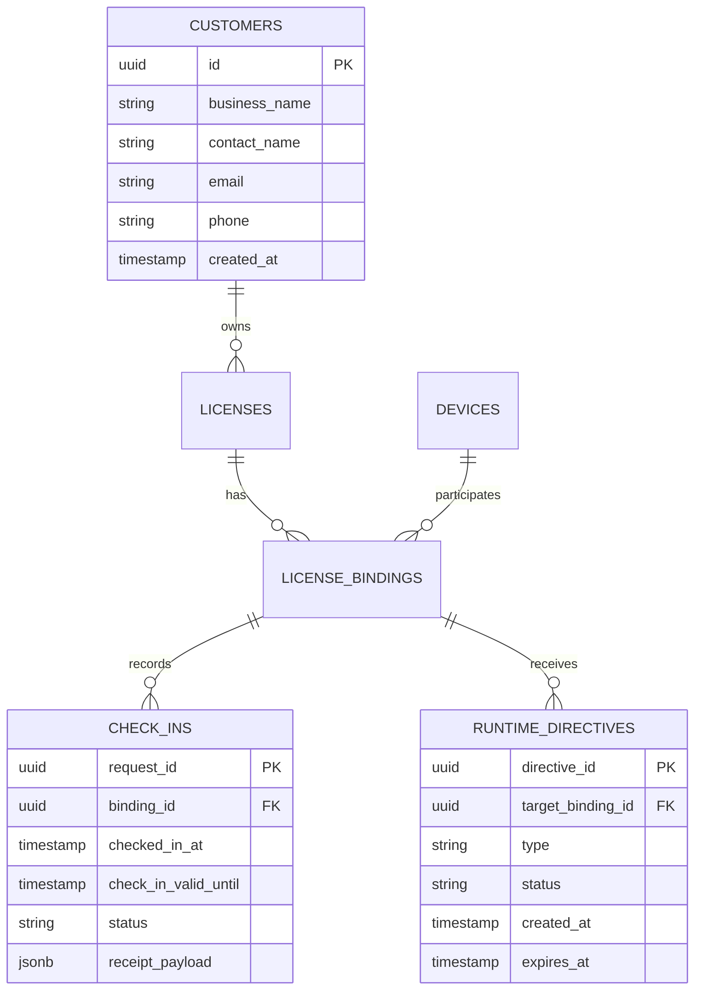

# License Management Data Model V1

## Database ER Diagram

## Additive Schema (Migrations)
- `customers`: Tracks the purchasing entity.
- `check_ins`: Append-only table tracking each successful check-in with its idempotency `request_id`.
- `runtime_checkin_requests`: Tracks in-flight or failed requests.
- `runtime_directives`: Allows admins to queue messages to specific bindings.
- `runtime_directive_deliveries`: Tracks when a client acknowledges a directive.

## Transaction Requirements
- **Runtime Check-In**: Must atomically create/update the `check_ins` record, update the `devices.last_seen_at`, and fetch pending directives. Savepoints and proper rollback/retry behavior on unique violation (idempotency) are critical.
- **Directive Delivery/Acknowledgement**: Atomic state transitions from `PENDING` -> `DELIVERED` -> `ACKNOWLEDGED`.
- **License Revoke**: Update `licenses.status = 'REVOKED'`, write `audit_events` atomically.
- **postgres.js Regression Tests**: Every new transactional block must include a postgres.js driver regression test ensuring savepoints and concurrency issues do not break the transaction completely, protecting against known past regressions.
