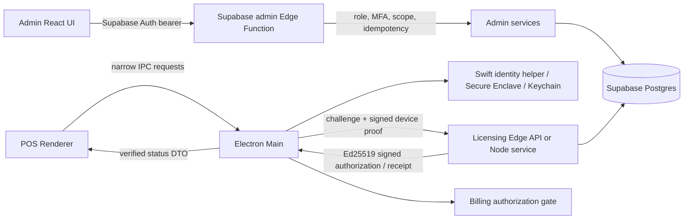

# Licensing Lifecycle Map — Phase A Discovery

**Date:** 2026-10-28  
**Purpose:** map the current request and state flow before implementation. Paths below refer to the current working tree, which has pre-existing changes.

## System boundary

## Admin lifecycle flows

### Sign-in and authorization

1. `admin-ui/src/pages/Login.tsx` authenticates through Supabase Auth.
2. `admin-ui/src/store/authStore.ts` stores the Supabase session and calls `admin-ui/src/api/auth.ts` (`GET /admin/me`).
3. `admin-ui/src/api/client.ts` attaches the bearer session token to the configured Admin API URL.
4. `supabase/functions/_shared/http/Router.ts` calls `adminAuth`, enforces route role and `requireMfa`, attaches verified auth context, and applies idempotency to mutations when a key is supplied.
5. `_shared/middleware/adminAuth.ts` resolves role/scope using server-side database state; services enforce tenant scope in their SQL.

### Issue license

`LicensesList` → `LicenseModal` collects product, max devices, valid-until, optional customer → `api/licenses.ts:createLicense` posts `/admin/licenses` with `X-Idempotency-Key` → `admin/index.ts` requires OWNER/ADMIN/FINANCE/SYSTEM plus MFA → `AdminLicenseService.createLicense` creates key material/hash and DB row → UI shows plaintext once in `PlaintextKeyModal` and refreshes list. The plaintext key is intentionally transient; never put it into Playwright logs/artifacts.

### Extend / disable / restore / revoke

`LicenseDetail` → `LifecycleModal` → `api/licenses.ts` → matching `/admin/lifecycle/*` route with role/MFA checks and idempotency → `AdminLifecycleService` transaction updates license/binding and records audit event → UI closes modal and refetches license details. Extend takes explicit `valid_until` and reason. Disable/restore/revoke are distinct status transitions; revoke is described as final and deactivates active bindings.

### Admin release / reassignment

`DevicesList` / `DeviceDetail` → `ReleaseBindingModal` → `/admin/lifecycle/release-binding` → server scope check and binding row lock → binding becomes DEACTIVATED with timestamp and audit event. Customer-scoped operators see only their own scoped device/binding information. The previous desktop may remain licensed offline until a validated check-in/directive or local authorization expiry; immediate offline revocation is not established.

## Desktop activation flow

1. Renderer `ActivationScreen` invokes `window.api.licensing.activate(licenseKey)` exposed by `electron/preload.ts`.
2. `electron/ipc/licensing.handlers.ts` validates non-empty input and calls `LicensingRuntimeService.activate` (main process).
3. Main obtains `deviceKeyId`, public key, and signature from `NativeDeviceIdentityAdapter`/Swift helper; the private key remains inside the Secure Enclave helper.
4. `LicensingClient.getChallenge` calls `/api/v1/activation/challenge`; main signs canonicalized challenge bytes with domain tag `MINIPOS-DEVICE-CHALLENGE-V1:`.
5. `POST /api/v1/activation` or equivalent Edge route validates request, verifies proof/challenge, hashes the license key, locks license row, checks status/time window/device limit, updates binding, and writes idempotency/audit data.
6. Server signs authorization over canonicalized payload using Ed25519 and configured key ID.
7. `LicensingService` verifies trusted signing key, signature, protocol, dates, and device match before atomically persisting authorization. Main returns only safe `LicensingStatusDTO` to renderer.
8. `LicensingBillingGate` permits finalization only when main-process state is ACTIVE. Any non-ACTIVE/unknown state fails closed.

## Deactivation flow

1. Renderer invokes `license:deactivate`; IPC delegates to `LicensingLifecycleService`.
2. Main reads local authorization, checks device ID, requests deactivation challenge, signs it with device key, then posts `/api/v1/lifecycle/deactivation`.
3. Server verifies proof, locks binding, marks it DEACTIVATED, writes lifecycle request/audit state.
4. Only after server success does Electron clear local authorization and recompute runtime status. A network failure leaves local authorization in place; deactivation is online-dependent.

## Runtime check-in / offline lease flow

1. `LicensingRuntimeService.initialize` loads/verifies local authorization and may asynchronously trigger a check-in on startup/resume.
2. `RuntimeCheckInCoordinator` obtains a fresh challenge, signs it with device identity, posts a unique request ID, verifies receipt signature/license/device binding, enforces server-time rollback ordering, then atomically persists the receipt.
3. Both server implementations sign `checkInValidUntil = min(server_now + 7 days, license.valid_until)` and include server timestamps/status/directives.
4. Desktop derives CURRENT/DUE_SOON/REQUIRED/OVERDUE from `checkInValidUntil`; after expiry its runtime state can become CHECKIN_OVERDUE. Billing is blocked for every state except ACTIVE.
5. A check-in can propagate disabled/revoked status only when online contact succeeds. No mechanism for instantaneous offline revocation was found in the traced flow.

### Policy mismatch to resolve

The product policy is confirmed: a seven-day signed offline lease blocks billing at lease expiry. Runtime comments and UI wording were aligned locally. QA test mode can shorten the server-issued lease only on the exact QA project and only while enabled; the receipt remains capped at commercial license expiry.

## State and boundary notes

- License commercial interval: `[valid_from, valid_until)` in activation code; current predicate rejects `now < valid_from` and `now >= valid_until`.
- License state: ACTIVE/DISABLED/REVOKED; expiry is also derived from time, not necessarily persisted as status.
- Binding state: ACTIVE/DEACTIVATED, with DB check constraint requiring `deactivated_at` for deactivated rows and partial unique index allowing one active license per device.
- Offline receipt: independently signed, has `checkInValidUntil`, capped at license expiry.
- Administrative revoke immediately changes server DB and active bindings but cannot reach disconnected clients until contact; local signed authorization can remain in storage until client expiry/check-in policy reacts.
- Administrative disable/restore semantics differ from revoke; restore allows DISABLED only and sets ACTIVE. The effect on bindings should be validated from actual server implementation and documented policy.

## Paths to inspect during implementation

`admin-ui/src/pages/Licenses/*`, `admin-ui/src/pages/Devices/*`, `admin-ui/src/api/*`, `supabase/functions/admin/index.ts`, `supabase/functions/api/index.ts`, `supabase/functions/_shared/{http,middleware,services,crypto,protocol}/*`, `supabase/migrations/*`, `server/licensing/src/{routes,services,crypto}/*`, `electron/licensing/*`, `electron/ipc/licensing.handlers.ts`, `electron/preload.ts`, `electron/native/*`, `src/application/use-cases/LicensingService.ts`, `src/shared/crypto/*`, `src/presentation/components/licensing/*`, root and admin-ui Playwright configs, `tests/e2e/licensing-real/*`, and licensing Vitest suites.

## Implementation update — 2026-10-28

- Admin `/me` reports QA identity only when its server-side Supabase URL hostname is the exact designated QA host.
- `GET/PUT /admin/qa/licensing-settings` are registered only for the designated QA ref. Writes require SUPPORT role and AAL2, validate fixed presets, persist an audit event, and can reset to disabled/7-day defaults.
- License creation accepts an explicit `qa_test_mode` request. The Edge service rejects that flag outside QA or while the test mode is disabled. When a short preset is selected, `valid_from` and `valid_until` are calculated server-side and returned from the created database row.
- New QA settings UI displays the verified project banner and selected intervals. License details separate binding state, last successful check-in, offline lease expiry, and commercial license expiry.
- `GET /admin/licenses/:id/lifecycle-status` returns only the caller-scoped binding/check-in history, with no signed receipt payload or license key.
- New migration: `supabase/migrations/20261006000000_qa_licensing_test_settings.sql`.
- The deployment/remote test lifecycle remains pending. Do not treat these local changes as hosted behavior until the additive migration and matching Edge Functions are deployed to QA and verified.
