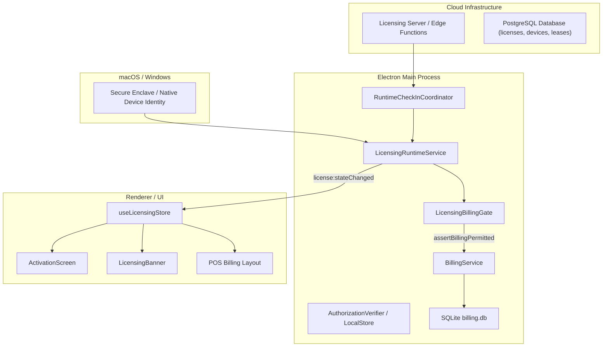
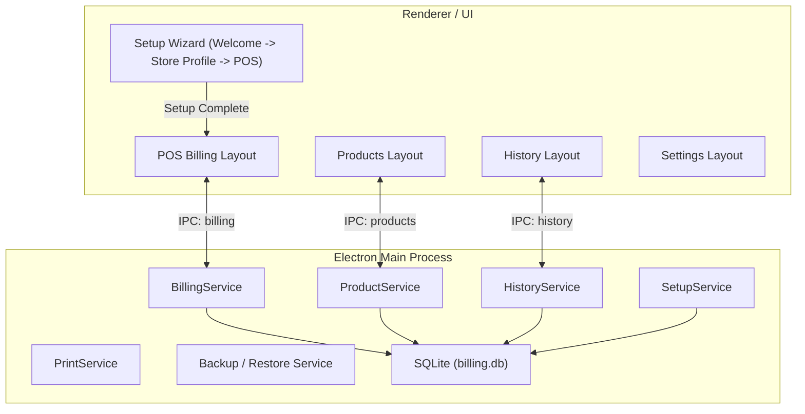

# Mini POS — Standalone Architecture & Licensing Removal Documentation
**Document Version:** 1.0  
**Branch:** `feature/complete-licensing-removal`  
**Status:** Completed

---

## 1. Executive Architectural Summary

Mini POS has been transformed from an online/hybrid license-entitled desktop system into a **fully standalone desktop Point of Sale application**. 

All architectural layers that enforced, validated, coordinated, or monitored software licensing, activation keys, device identity attestation, or runtime leases have been permanently and cleanly removed.

Mini POS now boots directly into its POS workflows, accesses only local SQLite persistence, requires zero network connectivity for billing, and has no background licensing check-ins, timers, or gates.

---

## 2. Architecture Comparison

### Before (License-Gated Architecture)

### After (Clean Standalone POS Architecture)

---

## 3. Subsystem Removal Analysis

### A. Electron Main Process
- **Deleted Subsystem:** `electron/licensing/` (`LicensingRuntimeService`, `LicensingBillingGate`, `LicensingLifecycleService`, `RuntimeCheckInCoordinator`, `LicensingClient`).
- **Startup Wiring:** `electron/main.ts` now creates repositories, instantiates core application services, registers IPC handlers, and immediately opens the application `BrowserWindow`.
- **Fail-Safe Startup:** There is no asynchronous licensing initialization before `createWindow()`. Even if old licensing artifacts exist on disk, the main process ignores them completely.
- **Power Hooks:** `powerMonitor.on('resume')` licensing refresh hook removed.

### B. Billing Authorization Path
- **Decoupled Billing:** In `src/application/use-cases/BillingService.ts`, the `IBillingAuthorization` dependency and `assertBillingPermitted()` check before `finalizeBill()` were removed.
- **Uncompromised Business Logic:** Core domain rules (item validations, inventory snapshots, transaction atomicity, bill sequencing, receipt formatting) operate identically and with 100% integrity without licensing restrictions.
- **Error Handling:** `BillingNotAuthorizedError` mapping in `electron/ipc/mappers.ts` was eliminated; IPC only translates domain errors and system exceptions.

### C. Renderer & UI Layer
- **Activation Screen Removed:** `src/presentation/components/licensing/ActivationScreen.tsx` and `LicensingBanner.tsx` deleted.
- **Zustand State Removed:** `src/application/state/licensingStore.ts` and `src/application/use-cases/LicensingService.ts` deleted.
- **Setup Flow Simplified:** `SetupLayout.tsx` changed from `WELCOME -> STORE -> ACTIVATION -> COMPLETE` to `WELCOME -> STORE -> COMPLETE`. On completion, users enter POS billing immediately.
- **Settings Screen Cleaned:** Deactivation buttons, license expiry dates, and simulate-offline QA toggles removed from `SettingsLayout.tsx`.

### D. Native Device Identity Helper
- **Deleted Native Helper:** `electron/native/MiniPOSIdentityHelper/` (Swift Secure Enclave identity helper) and `assets/native/MiniPOSIdentityHelper` deleted.
- **Deleted Adapters:** `NativeDeviceIdentityAdapter.ts` and `FakeDeviceIdentityProvider.ts` deleted.
- **Packaging:** `extraResources` mapping for native helper removed from `electron-builder.yml`.

### E. Cryptography & Serialization
- **Deleted Ed25519 / P-256 Verifiers:** `AuthorizationVerifier.ts`, `RuntimeCheckinReceiptVerifier.ts`, `AuthorizationPayload.ts`, `RuntimeCheckinReceiptPayload.ts`, and `canonicalize.ts` deleted.
- **Dependencies Removed:** `canonicalize` package uninstalled from `package.json`.

### F. Admin Panel
- **Removed License Management:** `admin-ui/src/pages/Licenses/` deleted (List, Detail, Create, Lifecycle, PlaintextKey modals).
- **Removed Device Binding UI:** `admin-ui/src/pages/Devices/` and `admin-ui/src/api/devices.ts` deleted.
- **Removed QA Licensing Settings:** `admin-ui/src/api/qaLicensing.ts` and test modes deleted.
- **Preserved Core Admin Responsibilities:** Customer accounts management, Audit logs, Admin authentication, and RBAC / MFA remain fully operational.

### G. Backend & Cloud Infrastructure
- **Client API Function Removed:** `supabase/functions/api/` (public device activation, challenge, and checkin endpoints) deleted.
- **Admin Function Cleaned:** `supabase/functions/admin/index.ts` stripped of all license, device-binding, and check-in routes, retaining only Customers, Audit, and Dashboard summary.
- **Standalone Server Deleted:** `server/` (legacy Express + PostgreSQL licensing server) deleted.

---

## 4. Architectural Verification Matrix

| Invariant | Target | Status | Verification Method |
|-----------|--------|--------|---------------------|
| No Activation Screen | App boots directly to Setup or POS | PASSED | Playwright E2E (`setup.e2e.spec.ts`) |
| Standalone Billing | Finalization requires no license gate | PASSED | Playwright E2E (`standalone-regression.e2e.spec.ts`) |
| Zero Network Dependency | 0 network calls to licensing endpoints | PASSED | Playwright request interceptor |
| Offline Resilience | Operates fully without internet | PASSED | Unit tests & E2E headless runs |
| Legacy File Immunity | Corrupt `authorization.json` ignored | PASSED | Standalone regression test suite |
| Build & Packaging Clean | Clean packaging without native helper | PASSED | `npm run build` & `electron-builder` |

