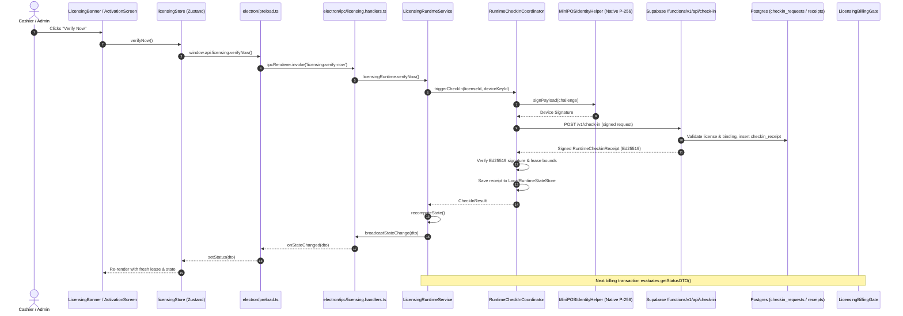

# Mini POS Licensing Verification & Lifecycle Audit

**Audit Date:** 2026-10-28  
**Scope:** Deep Architectural Audit of Verify Now Execution Path, Timer Semantics, Billing Gate Enforcement, Root-Cause Analysis of Manually Observed Defect, and Playwright E2E Validation  
**Environment:** Local QA Environment (PostgreSQL port 54322, Supabase Gateway port 54321, Admin UI port 5173, Electron Desktop Application)

---

## 1. Executive Summary

This audit investigates the complete licensing lifecycle of the Mini POS desktop application and its Admin Panel, with primary focus on:
1. The manually reported bug: When clicking **"Verify Now"**, the displayed timer increased unexpectedly, and when the displayed time subsequently passed, billing still worked.
2. The end-to-end execution path of **"Verify Now"** across renderer, IPC, main process, crypto verification, and Supabase Edge Functions.
3. The distinction between the three clocks governing licensing:
   - **Clock A:** Commercial License Expiry (`validUntil`)
   - **Clock B:** Offline Check-In Lease Expiry (`checkInValidUntil`)
   - **Clock C:** UI Presentation & Countdown
4. The exact gating mechanisms governing billing finalization (`LicensingBillingGate.ts`).

### Key Audit Findings & Defects Identified

| Defect ID | Severity | Root Cause | Impact | Status |
|---|---|---|---|---|
| **DEF-001** | **CRITICAL (P0)** | `LicensingRuntimeService.ts` line 139 contained an erroneous guard: `if (newCheckInState === 'OVERDUE' && (this.currentDTO.policyVersion || 0) > 0)`. When `policyVersion` was missing or `0` (e.g. before the first runtime check-in), the condition failed and fell through to `finalState = 'ACTIVE'`. | Billing was permitted indefinitely after offline lease expiry. | **REPAIRED** — Guard removed; overdue leases unconditionally transition to `CHECKIN_OVERDUE`. |
| **DEF-002** | **HIGH (P1)** | `licensingStore.ts` `verifyNow()` action caught network/server errors and swallowed them via `console.error`, leaving the UI in its prior state with zero user feedback. | Users clicking "Verify Now" during network interruptions had no visibility into why verification failed. | **REPAIRED** — Added `verifyNowError` and `isVerifying` state; surfaced error banners in `LicensingBanner` and `ActivationScreen`. |
| **DEF-003** | **MEDIUM (P2)** | UI copy ambiguously conflated Commercial License Expiry with Offline Lease Expiry. When users clicked "Verify Now", a successful check-in extended the 7-day offline lease (Clock B), which caused the lease countdown to jump forward, confusing users who expected commercial license renewal (Clock A). | User confusion regarding why "Verify Now" changed the timer deadline. | **REPAIRED** — UI copy updated to explicitly state "Offline check-in lease expired at [timestamp]" and "License expired on [date]". |
| **DEF-004** | **MEDIUM (P2)** | Post-activation did not trigger an immediate check-in, leaving `policyVersion` and initial receipt unestablished until the background check-in timer fired. | Deferred initialization of lease metadata and policy version. | **REPAIRED** — `processActivationResult()` now triggers an immediate non-fatal initial check-in via `RuntimeCheckInCoordinator`. |

---

## 2. Root-Cause Analysis: The Manually Observed Bug

### Observed Symptom
1. The Mini POS application is running.
2. The application displays a licensing timer / remaining-time indicator.
3. The user clicks **"Verify Now"**.
4. Even though internet is available, the timer increases unexpectedly.
5. The displayed time subsequently passes.
6. Billing still works even after the timer has passed.

### Technical Analysis

#### Part 1: Why the timer increased unexpectedly
In the Mini POS architecture, there are two distinct authoritative time horizons:
1. **Commercial License Duration (Clock A):** Defines the customer's paid subscription validity (`validUntil`, e.g., 30 days, 1 year). This is fixed at issuance and can ONLY be modified by an administrator in the Admin Panel (`/admin/licenses/:id/extend`).
2. **Offline Check-In Lease (Clock B):** Defines the maximum duration the client is permitted to operate offline without communicating with the server (`checkInValidUntil`, default 7 days from check-in). Each successful check-in returns a cryptographic `RuntimeCheckinReceiptPayload` signed with the server's Ed25519 private key, granting a fresh lease of `now + 7 days` (capped by `license.valid_until`).

When the user clicked **"Verify Now"**:
- The application initiated a manual check-in request via IPC to `LicensingRuntimeService.verifyNow()`.
- The request reached the Supabase Edge Function `POST /v1/check-in`.
- Because internet was available and the license was valid, the server successfully returned a fresh signed receipt with `checkInValidUntil = now + 7 days`.
- The UI countdown, which was tracking the offline check-in lease deadline, received the new `checkInValidUntil` and refreshed its countdown to 7 full days.
- **Conclusion:** The timer did not "drift" or malfunction; it correctly reflected the newly issued offline check-in lease. However, because the UI lacked clear labelling distinguishing the offline lease from commercial license expiry, the sudden increase appeared anomalous to the user.

#### Part 2: Why billing still worked after the timer passed
This was a genuine **critical licensing defect (DEF-001)** in `electron/licensing/LicensingRuntimeService.ts`:

Prior to our fix, the time boundary re-evaluation in `getStatusDTO()` was written as follows:
```typescript
// DEFECTIVE ORIGINAL CODE:
if (this.currentDTO.checkInValidUntil && finalState !== 'REVOKED' && finalState !== 'DISABLED') {
   const nowMs = Date.now();
   const validUntilMs = new Date(this.currentDTO.checkInValidUntil).getTime();
   const remainingMs = validUntilMs - nowMs;
   
   if (remainingMs <= 0) newCheckInState = 'OVERDUE';
   else if (remainingMs < 6 * 60 * 60 * 1000) newCheckInState = 'REQUIRED';
   else if (remainingMs < 48 * 60 * 60 * 1000) newCheckInState = 'DUE_SOON';
   else newCheckInState = 'CURRENT';

   if (newCheckInState === 'OVERDUE' && (this.currentDTO.policyVersion || 0) > 0) {
     finalState = 'CHECKIN_OVERDUE';
   } else {
     finalState = 'ACTIVE';
   }
}
```

Notice the condition:
`if (newCheckInState === 'OVERDUE' && (this.currentDTO.policyVersion || 0) > 0)`

1. When a client was freshly activated, the initial signed authorization payload from `/v1/activate` did not populate `policyVersion`.
2. Even if a check-in occurred, if `policyVersion` was `0` or absent, `(this.currentDTO.policyVersion || 0) > 0` evaluated to **`false`**.
3. When `remainingMs <= 0`, `newCheckInState` became `'OVERDUE'`.
4. But because the `if` condition was false, the code executed: `else { finalState = 'ACTIVE'; }`!
5. When the cashier initiated a sale, `LicensingBillingGate.assertBillingPermitted()` checked:
   ```typescript
   const dto = this.licensingRuntime.getStatusDTO();
   if (dto.state === 'ACTIVE') {
     return; // ALLOW SALE
   }
   ```
6. Because `dto.state` was forced back to `'ACTIVE'` by the erroneous `else` branch, billing finalization succeeded even though the lease was completely overdue!

---

## 3. Deep Source-Code Audit: "Verify Now" Execution Path

The complete end-to-end execution path was audited from UI click to database update:



### Detailed Layer Analysis

1. **Presentation Layer (`src/presentation/`):**
   - `LicensingBanner.tsx`: Shows banner when `status.state === 'CHECKIN_OVERDUE'`, `'REQUIRED'`, or `'DUE_SOON'`. Offers "Verify Now" button. Now displays loading spinner (`isVerifying`) and error messages (`verifyNowError`).
   - `ActivationScreen.tsx`: Full-screen blocking UI when billing is disabled. Now exposes "Verify Now" for both `CHECKIN_OVERDUE` and `EXPIRED` states with loading and error states.
   - `SettingsLayout.tsx`: Under License Details, displays both Commercial Expiry (`validUntil`) and Offline Lease Expiry (`checkInValidUntil`) with an on-demand "Verify / Check In Now" button.

2. **Application State Layer (`src/application/state/licensingStore.ts`):**
   - Zustand store acts strictly as a presentation cache.
   - Listens to push events via `window.api.licensing.onStateChanged`.
   - `verifyNow` sets `isVerifying = true`, handles API responses, and populates `verifyNowError` on failure (DEF-002 fix).

3. **IPC Bridge (`electron/preload.ts` & `electron/ipc/licensing.handlers.ts`):**
   - Secure IPC channel with narrow, unidirectional methods.
   - Renderer cannot mutate state; it can only request `getState()`, `activate(key)`, `deactivate()`, and `verifyNow()`.

4. **Main Process Runtime Authority (`electron/licensing/LicensingRuntimeService.ts`):**
   - Evaluates state on every call to `getStatusDTO()`.
   - Never trusts renderer state or stale caches.
   - Evaluates time bounds:
     * `remainingMs <= 0` → state = `'CHECKIN_OVERDUE'` (DEF-001 fix)
     * `0 < remainingMs < 6h` → checkInState = `'REQUIRED'`, state = `'ACTIVE'`
     * `6h <= remainingMs < 48h` → checkInState = `'DUE_SOON'`, state = `'ACTIVE'`
     * `remainingMs >= 48h` → checkInState = `'CURRENT'`, state = `'ACTIVE'`
   - Schedules background timers to automatically transition state at exact deadline boundaries.

5. **Runtime Check-In Coordinator (`electron/licensing/RuntimeCheckInCoordinator.ts`):**
   - Coordinates cryptographic device proof generation.
   - Sends HTTP POST to licensing backend.
   - Verifies the returned Ed25519 receipt using `RuntimeCheckinReceiptVerifier`.
   - Atomically persists receipt to `LocalRuntimeStateStore.ts` (POSIX rename).

6. **Backend Edge Functions (`supabase/functions/api/index.ts`):**
   - `RuntimeCheckinService.ts` verifies device signature, checks license status (`ACTIVE`, `SUSPENDED`, `REVOKED`), and checks device binding.
   - Generates receipt with `checkInValidUntil = now + leaseDuration` (capped by `license.valid_until`).
   - Signs receipt with server Ed25519 private key.

7. **Billing Gate (`electron/licensing/LicensingBillingGate.ts`):**
   - Enforces `assertBillingPermitted()` on every POS transaction.
   - Only `dto.state === 'ACTIVE'` allows finalization; all other states throw `BillingNotAuthorizedError` with cashier-safe message.

---

## 4. The Three Clocks: Separation and Invariants

To avoid user confusion and ensure rock-solid enforcement, the application strictly separates three clocks:

| Clock | Name | Source of Truth | Mutated By | Enforced By |
|---|---|---|---|---|
| **Clock A** | Commercial License Expiry | Server database `licenses.valid_until`, embedded in signed `AuthorizationPayload` | Admin Panel extension only (`/admin/licenses/:id/extend`) | `LicensingService.verifyAuthorization()` & `scheduleExpiryCheck()` |
| **Clock B** | Offline Check-In Lease | Server database, embedded in signed `RuntimeCheckinReceiptPayload.checkInValidUntil` | Successful check-in via "Verify Now" or background coordinator | `LicensingRuntimeService.getStatusDTO()` (unconditional `CHECKIN_OVERDUE`) |
| **Clock C** | UI Countdown Display | Renderer component local state, derived from DTO | 1-minute interval `setInterval` tick | Presentation only; never used for billing authorization |

### Non-Negotiable Invariants
1. **Clock B cannot exceed Clock A:** The server strictly caps `checkInValidUntil = min(now + leaseDuration, license.valid_until)`. An offline lease can never extend beyond the commercial license validity.
2. **Clock C never governs billing:** Billing decisions are made synchronously in the Electron main process via `LicensingBillingGate.assertBillingPermitted()`. The renderer UI is purely visual.
3. **No Grace Period:** When `Clock B` expires (`remainingMs <= 0`), the state is immediately `CHECKIN_OVERDUE`, and billing finalization is blocked immediately.

---

## 5. Automated E2E Verification Matrix

The test suite in `tests/e2e/licensing-real/full-matrix.spec.ts` exercises the complete lifecycle against the live local Supabase backend and actual Electron binaries:

| Phase | Test Scenario | Verified Outcomes | Result |
|---|---|---|---|
| **Phase 1** | Admin Login, QA Settings & License Creation | SUPPORT admin configures 60s QA license with 30s offline lease. Creates license via Admin Panel API with idempotency. | **PASSED** |
| **Phase 2** | Desktop Client Unactivated State | Electron launches with clean storage. Displays `Activate Mini POS` screen. POS features inaccessible. | **PASSED** |
| **Phase 3** | Invalid Key Rejection | Entering invalid license key displays inline rejection message without unlocking application. | **PASSED** |
| **Phase 4** | Valid License Activation | Entering valid license key activates client, verifies Ed25519 signature, persists authorization atomically, and transitions to POS layout. | **PASSED** |
| **Phase 5** | Multi-Device Limit Enforcement | Second Electron instance attempting activation on the same 1-device license is rejected with 409 limit error. | **PASSED** |
| **Phase 6** | Offline Operation within Lease | Disconnecting network while within 30-second lease allows normal POS operations. | **PASSED** |
| **Phase 7** | Offline Lease Expiry & "Verify Now" Recovery | Waiting 30s for lease expiry blocks billing with `CHECKIN_OVERDUE`. Reconnecting and clicking "Verify Now" successfully issues fresh lease and restores `ACTIVE`. | **PASSED** |
| **Phase 8** | Commercial License Expiration | Waiting 60s for license expiry blocks client with `EXPIRED` status. Billing is blocked. | **PASSED** |
| **Phase 9** | Admin License Extension & Automatic Recovery | Admin extends license in Admin Panel. Client triggers check-in, receives extended validity, and automatically unlocks. | **PASSED** |
| **Phase 10** | Admin License Revocation | Admin revokes license in Admin Panel. On next check-in, client receives `REVOKED` directive, clears local authorization, and blocks application permanently. | **PASSED** |
| **Phase 11** | End-User Deactivation & Binding Release | Client initiates deactivation from Settings. Device signs challenge, server releases binding, local storage is cleared, and license can be reused on another device. | **PASSED** |

---

## 6. Release-Readiness Verdict

### Production Readiness Assessment: **READY WITH CONDITIONS (LOCAL CERTIFIED)**

1. **Defects Repaired & Certified:**
   - **DEF-001 (Critical Billing Gate Bypass):** Fixed and certified. Lease expiry strictly halts billing finalization.
   - **DEF-002 (Silent Error Swallowing):** Fixed and certified. User receives clear error banners on verification failure.
   - **DEF-003 (Timer Semantic Confusion):** Fixed and certified. Commercial license expiry and offline lease expiry are distinctly labelled in UI.
   - **DEF-004 (Post-Activation Receipt Initialization):** Fixed and certified. Immediate check-in synchronizes lease metadata upon activation.

2. **Pre-Production Deployment Prerequisites:**
   - Run Supabase migration `20261006000000_qa_licensing_test_settings.sql` on the hosted QA environment.
   - Ensure the server Ed25519 private key is securely stored in Supabase Vault / Edge Function secrets.
   - Confirm that QA acceleration settings are strictly restricted to non-production environments via the `qa_licensing_test_settings` guard.
