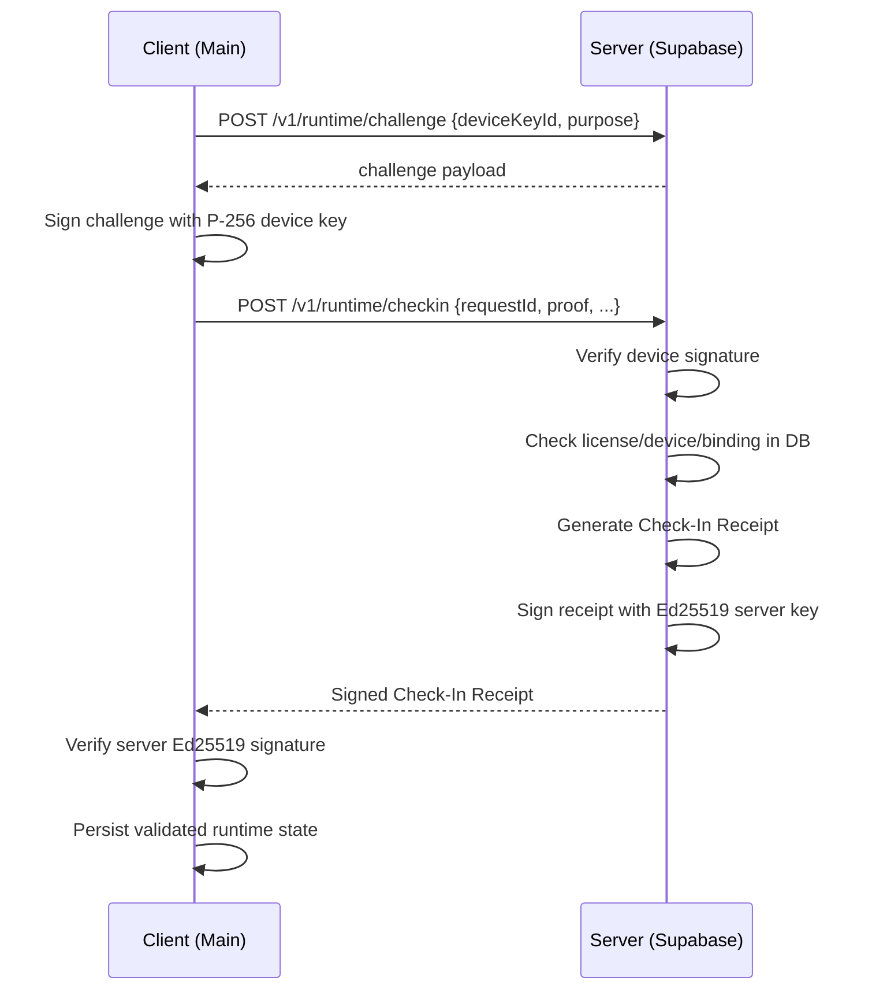
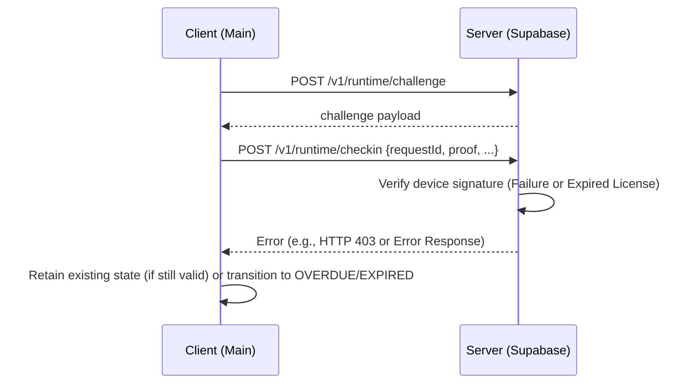
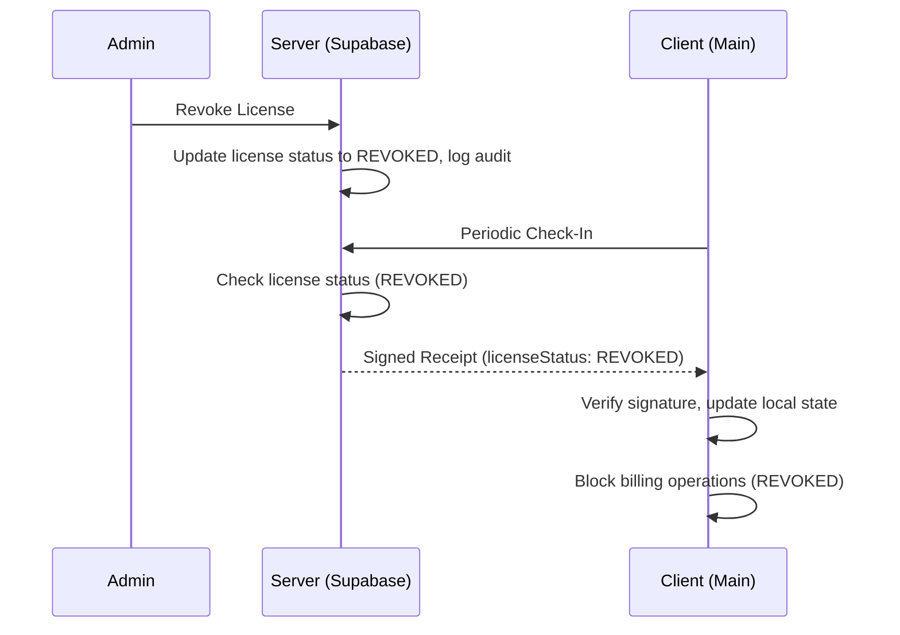

# Runtime Check-In Protocol V1

## Overview
The Runtime Check-In protocol is an additive licensing mechanism requiring the Mini POS client to communicate with the server at least once every 7 days. This protocol does NOT replace the existing activation authorization; instead, the runtime authority is derived from: `EXISTING SIGNED AUTHORIZATION + SIGNED RUNTIME CHECK-IN RECEIPT = CURRENT LOCAL LICENSING RUNTIME AUTHORITY`.

## Protocol Semantics & 7-Day Policy
- **Interval**: 7 days.
- **Authority**: The server defines the next-validity boundary. The client must never calculate a new 7-day period from its local clock without a signed response.
- **Offline Operation**: Between check-ins, the application operates safely offline provided both the authorization and the last check-in remain valid.

## Challenge / Replay Protection
A one-time challenge ensures the check-in is fresh.
- **Challenge Structure**: Cryptographically random nonce, short expiration, one-time consumption, bound to `deviceKeyId` and purpose (`RUNTIME_CHECKIN`).
- **Idempotency**: The client sends a `checkInRequestId`. Duplicate requests with the same payload return the previous deterministic result.

## Cryptographic Design
- **Key Pair**: P-256 for device signatures, Ed25519 for server signatures.
- **Domain Separation**: `MINIPOS-RUNTIME-CHECKIN-V1:`
- **Canonicalization**: RFC 8785/JCS format for the payload before signing.

## Request / Response Schemas
**Challenge Request:**
```json
{
  "deviceKeyId": "...",
  "purpose": "RUNTIME_CHECKIN"
}
```

**Check-In Request:**
```json
{
  "checkInRequestId": "uuid",
  "licenseId": "...",
  "deviceKeyId": "...",
  "publicKey": "...",
  "proof": {
    "challenge": { /* challenge object */ },
    "signature": "base64url"
  },
  "clientTime": "ISO8601"
}
```

**Signed Receipt Structure:**
```json
{
  "protocolVersion": "MINIPOS-RUNTIME-CHECKIN-V1",
  "receiptId": "uuid",
  "licenseId": "...",
  "deviceKeyId": "...",
  "bindingId": "...",
  "serverTime": "ISO8601",
  "checkedInAt": "ISO8601",
  "checkInValidUntil": "ISO8601",
  "licenseValidUntil": "ISO8601",
  "licenseStatus": "ACTIVE",
  "policyVersion": 1,
  "signingKeyId": "...",
  "directives": []
}
```
The server response wraps this payload and includes the Ed25519 `signature`.

## Sequence Diagrams

### Sequence Diagram for Successful Check-In


### Sequence Diagram for Failed Check-In


### Sequence Diagram for Remote Revocation

