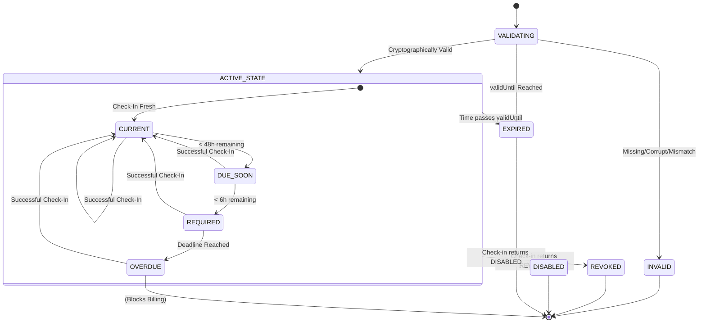

# Runtime Check-In State Machine V1

## Runtime States & Precedence
1. **REVOKED / DISABLED / EXPIRED / INVALID AUTHORIZATION / DEVICE MISMATCH**: Billing denied. Immediate rejection.
2. **VALID AUTHORIZATION + CHECK-IN OVERDUE**: Billing denied until check-in succeeds.
3. **VALID AUTHORIZATION + CHECK-IN REQUIRED**: Attempt network verification immediately. If offline, billing is denied.
4. **VALID AUTHORIZATION + CHECK-IN DUE_SOON**: Billing allowed + warning shown.
5. **VALID AUTHORIZATION + CHECK-IN CURRENT**: Billing allowed.

## State-Machine Diagram

## Warning UX Policy
- **> 48 hours remaining**: Normal app + subtle warning.
- **> 24 hours remaining**: Prominent warning.
- **> 6 hours remaining**: Persistent warning + "Verify Now".
- **Deadline reached**: Billing unavailable until successful verification.
- Messages must not delete data; they merely gate the billing function.

## Automatic Check-In Triggers
- Application startup
- Application resume (wake from sleep)
- Explicit "Verify Now" user action
- When transitioning into `DUE_SOON`
- Network recovery event (debounced)

**Request Storm Prevention**:
- Exponential backoff on failure.
- Minimum retry interval (e.g., 5 minutes).
- Deduplication of concurrent requests.
