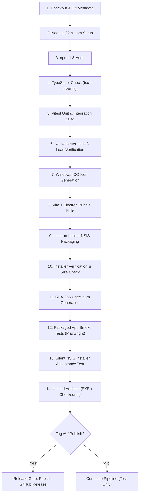

# Mini POS — Windows CI/CD & Automated Release Pipeline

## 1. Overview & Architecture

The Windows build, verification, and distribution pipeline is codified in:
```
.github/workflows/windows-release.yml
```

The workflow runs on a native **`windows-latest`** GitHub-hosted runner (Windows Server 2022/2025 x64), ensuring that all Windows-specific file semantics, native Node-API bindings, NSIS installer builders, and Playwright packaged smoke tests are validated directly on the target operating system.

---

## 2. Trigger Strategy & Branch Matrix

| Trigger Event | Target / Filter | Pipeline Purpose |
|---|---|---|
| **Push** | `feature/windows-edition` | Continuous validation of Windows compatibility changes during development. |
| **Pull Request** | `main` | Mandatory gate: blocks merge if any Windows compilation, test, or packaging step fails. |
| **Push (Tag)** | `v*` (e.g., `v1.0.0`) | Official release candidate: runs full test matrix, builds signed/unsigned installer, computes SHA-256, and executes the Release Gate. |
| **Workflow Dispatch** | Manual Trigger | On-demand builds with optional release publication flag (`publish: true/false`). |

---

## 3. Step-by-Step Execution Lifecycle

The workflow consists of two coordinated jobs:



### Detailed Step Breakdown:

#### 1. Repository Checkout & Metadata Capture
- Actions: `actions/checkout@v4` with `fetch-depth: 0`.
- Records git SHA, branch name, and short commit hash into environment variables.

#### 2. Node.js Environment Setup
- Actions: `actions/setup-node@v4` pinned to Node.js 22 with npm cache enabled.
- Captures `node --version` and `npm --version` in log output.

#### 3. Deterministic Dependency Installation
- Executes `npm ci` ensuring strictly reproducible `node_modules` matching `package-lock.json`.
- Runs `npm audit --audit-level=critical` to prevent supply chain vulnerabilities.

#### 4. TypeScript Static Analysis
- Runs `npx tsc --noEmit`.
- Fails immediately if any type definitions or IPC signatures have drifted.

#### 5. Unit & Integration Test Suite
- Runs `npm test -- --reporter=verbose` (Vitest).
- Runs 126 unit/integration tests spanning domain rules, billing math, SQLite repositories, ESC/POS renderer, PDF generator, and store settings.

#### 6. Native Module Verification (`better-sqlite3`)
- Executes an inline Node.js verification script directly on the Windows runner.
- Loads `better-sqlite3` and executes an in-memory query (`SELECT 42 AS answer`).
- Validates that the prebuilt `win32-x64.node` binary matches the runtime without compiling from source.

#### 7. Windows Multi-Resolution Icon Generation
- Executes `node scripts/generate-icons.mjs`.
- Reads `build/icon.png` (512x512) and generates `build/icon.ico` embedding 7 PNG resolutions (16, 24, 32, 48, 64, 128, 256).

#### 8. Application Bundle Build
- Runs `npm run build` (`tsc && vite build`).
- Generates web assets in `dist/` and transpiled Electron main/preload scripts in `dist-electron/`.

#### 9. NSIS Package Creation
- Executes `npx electron-builder --win --x64 -p never`.
- Packages ASAR archive, bundles dependencies, and compiles the NSIS installer executable.
- Uses Authenticode signing credentials if provided in GitHub Secrets.

#### 10. Installer Output Verification
- Locates the generated `.exe` installer in `release/`.
- Verifies non-empty file size and records filename.

#### 11. SHA-256 Checksum Computation
- Calculates cryptographic SHA-256 digest via PowerShell `Get-FileHash`.
- Writes digest and filename into `release/SHA256SUMS.txt`.

#### 12. Packaged App Smoke Tests (Playwright)
- Installs Playwright Chromium dependencies.
- Executes `MINIPOS_E2E_TEST=true node scripts/verify-packaged.js`.
- Launches the unpacked Windows executable (`release/win-unpacked/Mini POS.exe`).
- Confirms window title, IPC handlers, SQLite queries, and settings persistence.

#### 13. Silent NSIS Installer Acceptance Test
- Runs installer in headless silent mode: `Start-Process -FilePath $installer -ArgumentList "/S", "/D=$testInstallDir" -Wait`.
- Asserts exit code `0`.
- Verifies executable and uninstaller binary presence in the target install folder.

#### 14. Artifact Upload
- Uses `actions/upload-artifact@v4`.
- Uploads `release/*.exe` and `release/SHA256SUMS.txt` with 30-day retention.
- Uploads test logs and reports with 7-day retention.

---

## 4. Release Gate Job (`release-gate`)

The `release-gate` job acts as the final gatekeeper:
- **Condition**: Only triggers on version tags (`refs/tags/v*`) AND only if `windows-build-test` completes with 100% success.
- **Enforcement**: If any unit test, type check, packaging step, or smoke test fails, this job is skipped and no release is published.
- **Action**: Downloads artifacts, validates `SHA256SUMS.txt`, and publishes a formal GitHub Release via `softprops/action-gh-release@v2`.

---

## 5. Environment Secrets & Code Signing Configuration

To enable Authenticode code signing in CI:

| Secret Name | Format / Value | Description |
|---|---|---|
| `WIN_CSC_LINK` | Base64-encoded string | Base64 representation of the `.pfx` or `.p12` code signing certificate. |
| `WIN_CSC_KEY_PASSWORD` | Plaintext string | Password unlocking the private key inside the `.pfx`. |
| `GITHUB_TOKEN` | System-provided | Used by GitHub Actions to publish release assets and tag notes. |

### How to configure `WIN_CSC_LINK`:
On a local machine with the `.pfx` certificate:
```bash
# macOS / Linux:
base64 -i my-cert.pfx | tr -d '\n' > cert_base64.txt

# Windows (PowerShell):
[Convert]::ToBase64String([IO.File]::ReadAllBytes("my-cert.pfx")) | Out-File -Encoding utf8 cert_base64.txt
```
Copy the contents into the GitHub repository under **Settings > Secrets and variables > Actions > WIN_CSC_LINK**.
